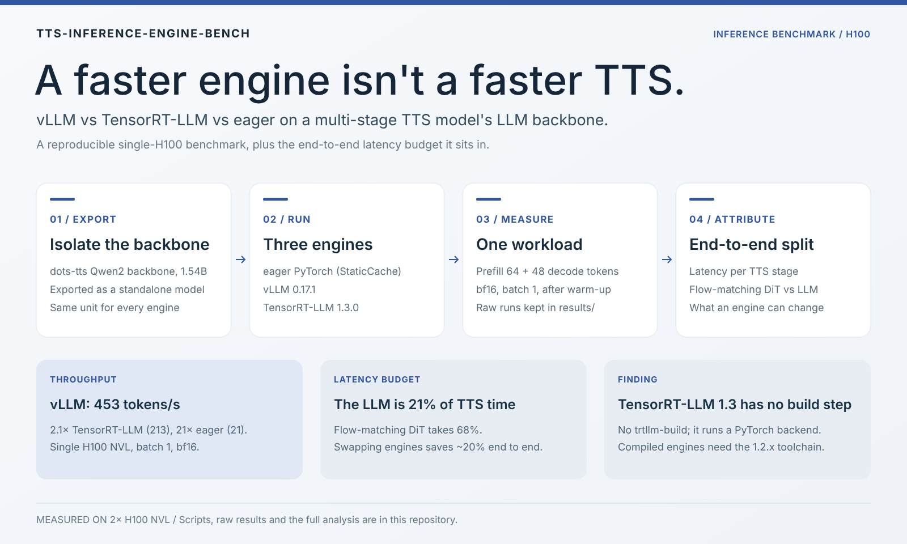
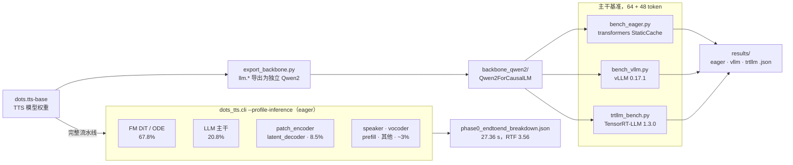

<div align="center">

# TTS 模型 LLM 主干上的 vLLM 与 TensorRT-LLM 对比

[English](README.md) · **简体中文**

**更快的 LLM 引擎不等于更快的 TTS：一次组件级基准测试，以及它所处的端到端延迟预算。**

在 TTS 模型 LLM 主干上对比 vLLM / TensorRT-LLM / eager 的推理性能


[](https://www.ccao2679.com/research/#tts-inference-engine-bench)



</div>

一套可复现的基准，在 NVIDIA H100 上对比**现代多阶段 TTS 模型中自回归 LLM 主干**的三种推理路径：**eager PyTorch**、**vLLM 0.17.1** 和 **TensorRT-LLM 1.3.0**。

> 速读（TL;DR）：
> 本仓库用一套可控负载，在 dots-tts（1.543B Qwen2 主干，28 层）上对比三种 LLM 推理路径，并给出**端到端 TTS 延迟拆分**。核心结论：
> - LLM 主干一层：**vLLM ≈ 453 tok/s > TensorRT-LLM ≈ 213 tok/s >> eager ≈ 21 tok/s**（vLLM 约快 TRT-LLM 2×，两者约快 eager 10–21×）。
> - 但整条 TTS 里 **LLM 只占 ~21% 延迟**，扩散流匹配层占 ~68% —— 后者不在 vLLM/TensorRT-LLM 的定义域内。引擎优化对端到端 TTS 的杠杆有限（~20%）。
> - 诚实边界：TensorRT-LLM 1.3.0 已**移除经典"编译 TensorRT 引擎"路径**（无 `trtllm-build`），默认跑 PyTorch 执行栈；真·编译 TRT 引擎需回退 1.2.x 旧工具链。

---

<!-- problem-framing:start -->

## 问题与依据

> **在模型、负载和计时定义都相同的前提下，更换自回归推理引擎能在多大程度上改善完整的 TTS 延迟，而不只是提升主干的 token 吞吐？**

**为什么值得解决：** 孤立的组件加速可能夸大用户实际听到的收益。引擎选型应当以实测的端到端成本和质量约束为依据。

**核心矛盾：** 高度优化的解码可能只加速了其中一个阶段，而声学生成、初始化或批处理仍占主导。warmup、token 计数的分母以及聚合方式的选择，也可能制造出表面上的引擎差异。

[完整问题与验证计划](PROBLEM.zh.md) · [English](PROBLEM.md)

<!-- problem-framing:end -->

## 架构



导出这条路径是引擎之间的正面对比：三个脚本跑的是同一个导出的主干，负载也完全相同——64 个合成 token 的 prefill 加 48 步贪心解码（bf16，batch 1）。`dots_tts.cli --profile-inference` 框是由 dots-tts 内置 profiler 计时的完整 TTS 流水线；框内各阶段标注的是其在端到端耗时中的占比，并不代表执行顺序。

## 1. 结果

三个引擎使用相同负载：**prefill 64 token + 自回归生成 48 token**，**bf16，单卡 H100 NVL，batch=1**。

| 引擎 | 总耗时 (s) | 每 token (ms) | tokens/s | 相对 eager |
|---|---|---|---|---|
| eager PyTorch（StaticCache）基线 | 3.698 | 46.7 | 21.4 | 1.0× |
| **TensorRT-LLM 1.3.0**（PyTorch backend） | 0.226 | 4.71 | 212.5 | **9.9×** |
| **vLLM 0.17.1** | **0.106** | **2.21** | **452.8** | **21.2×** |

> 在 batch=1 的 1.5B 小模型上，vLLM 比 TensorRT-LLM 快约 2.1×；两者都比 eager 快一个数量级。

> **测量说明。** vLLM 和 TensorRT-LLM 先预热一次，再取 3 次中的最好成绩；`scripts/bench_eager.py` 只计时一次，没有预热。eager 的 tokens/s 是 48 个 token 除以解码循环的时间，而 vLLM 和 TensorRT-LLM 的 tokens/s 是 token 数除以整个 `generate()` 调用的时间（含 prefill），所以「相对 eager」一列比较的量并不完全相同。按总耗时计算，倍数为 16.4×（TensorRT-LLM）和 34.9×（vLLM）。用预热后、取 3 次最好成绩的 eager 基线重测，尚待进行。

### 端到端延迟拆分（为什么 LLM 层不是瓶颈）

dots-tts 完整流水线合成 7.68 s 语音（eager，bf16，1×H100）时各阶段的占比：

| 阶段 | 秒 | 占比 |
|---|---|---|
| **Flow-matching DiT（扩散 / ODE）** | 18.56 | **67.8%** |
| **LLM 主干（Qwen2 AR 解码）** | 5.69 | **20.8%** |
| patch encoder / latent decoder | 2.31 | 8.5% |
| speaker / vocoder / prefill / 其他 | ~0.8 | ~3% |
| **总计** | **27.36** | 100%（RTF 3.56） |

由于 LLM 层只占端到端延迟的 ~21%，把它换成 vLLM（≈ 0.1–0.2 s）可以把总耗时从 ~27.4 s 降到 ~21.8 s——**端到端约 20% 的提升**。TTS 的时间真正花在扩散阶段，而 **vLLM 和 TensorRT-LLM 都不负责扩散阶段**。

---

## 2. 这里说的"TensorRT-LLM"到底是什么

这是一个发现，而不是假设：**TensorRT-LLM 1.3.0（release:1.3.0rc23）已不再提供经典的"编译 TensorRT 引擎"路径**——没有 `trtllm-build`，没有 `convert_checkpoint`，也没有 `tensorrt_llm.builder` 模块。CLI 只提供 `trtllm-serve` / `trtllm-bench` / `trtllm-eval`，高层 `LLM` API 现在默认使用 **PyTorch 执行后端**（优化过的 torch + FlashAttention + 图编译），另有 `_autodeploy` 作为前沿备选。

> 因此，本仓库的"TensorRT-LLM vs vLLM"是在**当前官方默认执行栈**上的对比，**不是**"手写编译 TRT 图 vs vLLM"。如果一定要编译 TRT 引擎的数字，需要使用仍捆绑 TensorRT 10.14 与旧 builder 的 1.2.x 工具链（详见 [docs/05_reproduction.md](docs/05_reproduction.md)）。

---

## 3. 被测模型

- **dots-tts**（`rednote-hilab/dots.tts-base`），一个多阶段 TTS，内部 LLM 主干是 **1.543B、28 层的 `Qwen2ForCausalLM`**（hidden 1536，12 个注意力头 / 2 个 KV 头，vocab 151,672，输入输出嵌入权重共享）。
- 基准**只针对导出的独立 Qwen2 主干**（`llm.*` 权重，见 `scripts/export_backbone.py`），保证两个 LLM 引擎在同一个可比单元上竞争。
- 扩散 DiT / vocoder / 编码器只出现在端到端拆分里（两个引擎都不负责它们）。

### 为什么多阶段 TTS 值得研究

TTS 大致分两类，本仓库研究的是 diffusion / 多阶段这一类：

- **多阶段 / 扩散 TTS**（dots-tts、VoxCPM2）：LLM 预测 latent → **扩散流匹配**精修 → vocoder 渲染。LLM 只占一部分开销，扩散层占主导。
- **纯 AR TTS**：LLM 直接自回归输出波形（几乎没有扩散）。此时 LLM 层就是整个模型，vLLM/TRT-LLM 拥有全部杠杆。

**这一洞察可以推广：LLM 推理引擎的价值与 LLM 在端到端成本中的占比成正比。**

---

## 4. 复现

完整步骤（conda/venv、容器、命令）见 [`docs/05_reproduction.md`](docs/05_reproduction.md)。一键概览：

```bash
# 0. export the Qwen2 backbone from the TTS checkpoint (once)
python scripts/export_backbone.py --src <tts_snapshot> --tgt backbone_qwen2

# 1. eager baseline
CUDA_VISIBLE_DEVICES=1 python scripts/bench_eager.py --model-dir backbone_qwen2

# 2. vLLM (conda env vllm-qwen, vllm 0.17.1)
CUDA_VISIBLE_DEVICES=1 python scripts/bench_vllm.py --model-dir backbone_qwen2

# 3. TensorRT-LLM (NGC container nvcr.io/nvidia/tensorrt-llm/release:1.3.0rc23)
docker run --gpus all -v "$PWD":/bench ... python /bench/scripts/trtllm_bench.py --model-dir /bench/backbone_qwen2
```

原始数据在 [`results/`](results/)。

---

## 5. 关键收获与行业应用

> 这些实验的结论不只是"哪个引擎快"，而是一套可以迁移到生产环境和复合模型上的判断框架。下面是四条关键收获和六条行业落地建议（详版见 [docs/04_analysis.md](docs/04_analysis.md)）。

**关键收获**

1. **基准粒度必须匹配架构——组件上的胜利不等于系统上的胜利。** "vLLM 比 TRT-LLM 快 2×"只在 LLM 层成立；扩散占 TTS 延迟的 ~68%，所以端到端只降 ~20%。宣布赢家之前，先把架构单元隔离出来。

2. **先测延迟预算，再谈优化。** 端到端拆分是价值最高的产出——它推翻了"LLM 引擎更快 → TTS 更快"的直觉。按*时间花在哪里*做决策，而不是按*哪个引擎最快*。

3. **工具栈在变，命名有歧义。** "TensorRT"（图编译器）和"TensorRT-LLM"（一个框架，1.3 版默认是 PyTorch backend）是两回事；编译引擎的路径已被移除。引用基准数据时，务必固定版本 + backend + 硬件 + batch + 精度。

4. **杠杆可以推广。** `LLM 引擎价值 ∝ LLM 占端到端成本的比例`——纯 AR TTS 约为 100%，扩散 TTS 约为 21%。

**行业落地建议**

1. **把延迟预算／阶段归属分析定为工程惯例**——选择推理基础设施之前，先生成一张每阶段的 RTF 表（profiler / nsys / CUDA events）；汇报*时间花在哪里*，而不是*哪个引擎最快*。

2. **按阶段选引擎，而不是按品牌。** AR 阶段用 LLM 推理引擎（vLLM / TRT-LLM），DiT / vocoder 单独走一条路径（ONNX / TensorRT / torch.compile / Triton）。扩散层杠杆最高的是 **ODE**：通过蒸馏减少 `num_steps`，并跨 patch 批量执行 ODE。

3. **受扩散限制时，模型级杠杆胜过引擎级杠杆**——步数蒸馏、更便宜更快的 vocoder、用**流式／分块合成**压低首包音频延迟（TTFA），以及数据侧的杠杆（更短、更干净的句子）。

4. **面向实时语音／同声传译，目标是端到端 RTF < 1 且 TTFA 可控。** 这里即使是 eager，LLM 层也已经是 RTF 0.74（快于实时）；真正的*墙*是 RTF 2.4 的扩散阶段——应主攻扩散／声学阶段和流式，而不是再换一个 LLM 服务。

5. **生产级基准纪律**——固定版本 + backend + GPU + batch + dtype，保留原始运行数据，在真实并发和模型规模下重新测试，并维护一份 **latency-budget 文档**作为唯一可信来源。

6. **数据团队对延迟有真实但间接的杠杆**——更短更干净的 utterance、speaker-disjoint 切分，以及**在固定评测集上做 RTF 回归测试**。一张实测的延迟拆分表，就是论证"应该投入扩散和评测数据，而不是再换一个 LLM 引擎"的硬证据。

---

## 6. 文档

- [`docs/01_background.md`](docs/01_background.md) — 为什么要做这项对比；TTS 架构；引擎定位
- [`docs/02_methodology.md`](docs/02_methodology.md) — 实验设计、公平性、环境
- [`docs/03_results.md`](docs/03_results.md) — 完整表格 + 端到端拆分
- [`docs/04_analysis.md`](docs/04_analysis.md) — 结果解读、适用边界、关键收获、行业应用
- [`docs/05_reproduction.md`](docs/05_reproduction.md) — 精确复现步骤 + 实现中踩过的坑

## 7. 许可

MIT。模型和引擎的许可证归各自所有者（dots-tts / NVIDIA TRT-LLM，以其发布版本为准）。

---

*基准产物与数字均由本仓库脚本在 2× H100 NVL 服务器上实测得到。*
